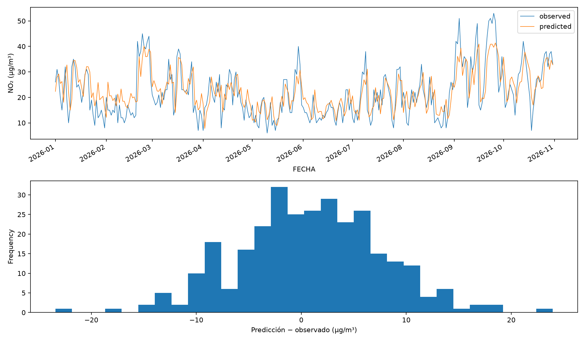

# Evaluación NO₂

Modelo seleccionado en validación: **ridge_basic**.

Predicciones históricas secuenciales; no equivalen a un servicio operativo.

| Partición | Inicio | Fin | Días |
|---|---|---|---|
| train | 2023-01-02 | 2024-11-30 | 693 |
| validation | 2025-01-02 | 2025-12-31 | 362 |
| test | 2026-01-01 | 2026-10-31 | 300 |

| Validación | MAE | RMSE |
|---|---|---|
| persistence | 7.036 | 8.994 |
| ridge_basic | 6.311 | 7.889 |
| ridge_full | 6.408 | 8.018 |
| hist_full | 7.166 | 9.008 |

| Test reservado | MAE | RMSE |
|---|---|---|
| selected | 5.440 | 6.886 |
| persistence | 5.537 | 7.279 |

Métricas en µg/m³; el MAE no es un intervalo de confianza.

Desglose mensual y concentraciones altas: `metrics.json`.

